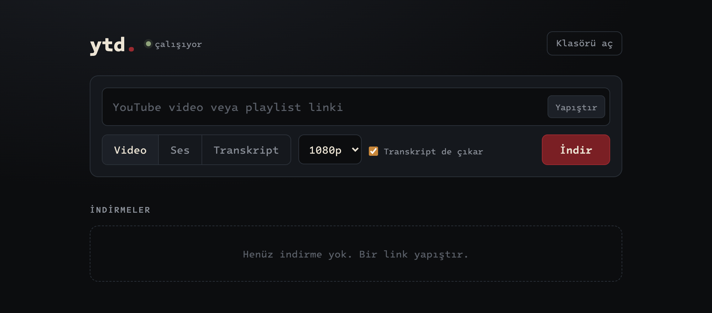

# ytd

Kişisel YouTube indirici: video, ses ya da sadece transkript. Mac'te çalışan küçük bir yerel web arayüzü (yalnızca `127.0.0.1`), arkada [yt-dlp](https://github.com/yt-dlp/yt-dlp).



> Yalnızca indirme hakkın olan içerik için (kendi videoların, izin verilen ya da serbest lisanslı içerik) ve YouTube'un kullanım koşullarına uyarak kullan.

## Neler yapar

- **Video:** varsayılan **AV1 + Opus (MKV)**, 2160p'ye kadar: aynı kalitede H.264'ün yaklaşık yarı boyutu (VLC / Chrome açar, QuickTime açmaz). İstenirse **H.264 + AAC (MP4)**: QuickTime'da açılır ama YouTube H.264'ü en fazla 1080p verir. Ölçüm: [docs/video-av1-olcum.md](docs/video-av1-olcum.md).
- **Ses:** M4A, yeniden kodlamadan (~128 kbps; "düşük" seçeneği ~48 kbps) ya da **Opus** (YouTube'un kendi Opus akışı, ~110–150 kbps, yine yeniden kodlamadan; `.opus` dosyası). Kapak ve bilgiler gömülü. Opus ile Whisper doğruluğu M4A ile aynı, dosya biraz daha küçük: ölçüm [docs/opus-whisper-olcum.md](docs/opus-whisper-olcum.md).
- **Transkript:** yükleyenin altyazısı varsa onu kullanır; yoksa yalnızca sesi geçici olarak alıp bu Mac'te Whisper ile (mlx-whisper) yazıya çevirir. `.txt` ve zaman damgalı `.srt` yazar.
- **"Transkript de çıkar":** indirilen her dosyanın yanına metnini ekler.
- **Playlist:** tek linkle bütün liste; daha önce indirilenler atlanır (`.archive-*.txt`).
- Dosyalar `~/Downloads/ytd/<kanal>/<başlık> [<id>].<uzantı>` olarak iner; "Klasörü aç" Finder'da gösterir.

## Özel, üyelere özel ve yaş sınırlı videolar

Herkese açık videolar hesapsız iner. YouTube bir video için hesap isterse (sana paylaşılmış özel video, üyesi olduğun kanalın üyelere özel videosu, yaş doğrulaması) aynı istek bir kez de senin hesabınla denenir. Instagram da önce hesapsız denenir; hesap yalnızca gerektiğinde ve sınırlı kullanılır (aşağıya bak).

Hesap, ytd'nin kendi Chrome profilinden okunur (`~/Library/Application Support/ytd/chrome`). Bu profile bir kez giriş yapman yeter: arayüzde **Giriş** düğmesine bas (ya da `.venv/bin/python ytd.py --login`); açılan Chrome penceresinde YouTube'a (istersen Instagram'a da) gir ve pencereyi kapat. İlk okumada macOS Keychain izin sorabilir; "Her Zaman İzin Ver" de. Çerezler yalnızca bellekte tutulur, diske yazılmaz.

Neden ayrı profil: macOS, Chrome'un ana profilini başka programlardan koruyor. Ayrıca günlük gezinme oturum çerezlerini sürekli yenilediği için ayrı profildeki giriş daha uzun süre geçerli kalıyor.

### Instagram hesabını yormamak

Instagram gönderileri önce hesapsız denenir; herkese açık reel ve gönderilerin çoğu böyle iner ve hesaba hiç dokunulmaz. Hesap yalnızca Instagram'ın sadece giriş yapmış kullanıcıya gösterdiği gönderilerde kullanılır ve o da sınırlıdır: saatte en fazla 30 hesaplı istek, aralarında en az 8 saniye. Instagram hesabın isteklerini keserse (boş yanıt, 429, doğrulama) ytd 3 saat boyunca hesapla istek atmaz; hesapsız inenler bu sürede de iner. Durum `~/Library/Application Support/ytd/instagram_account.json` dosyasında tutulur. Toplu indirmelerde ana hesabın yerine ikinci bir Instagram hesabıyla giriş yapmak daha güvenlidir.

## Kurulum

Gerekenler: macOS, Python 3, `ffmpeg` (`brew install ffmpeg`). Whisper ile transkript için Apple Silicon ve [Ses Bölücü](https://github.com/DenizTanisman/media-splitter) yardımcısının kurduğu mlx-whisper.

```sh
python3 -m venv .venv
.venv/bin/pip install -r requirements.txt
.venv/bin/python server.py          # http://127.0.0.1:8765
```

Her açılışta kendiliğinden hazır olsun istersen:

```sh
./install-autostart.sh
```

launchd portu tutar; sayfa açılınca sunucu başlar, 5 dakika boşta kalınca kapanır (arka planda sürekli çalışmaz).

## Claude'dan kullanma (MCP)

`mcp_server.py` ytd'yi Claude'a araç olarak verir (Claude Code ve Claude Desktop'a kayıtlı, sunucu adı `ytd`). Claude'a link verip "transkriptini çıkar" ya da "videoyu indir" demek yeter.

- `get_transcript`: önce bu Mac'te daha önce çıkarılmış transkripte bakar. Yoksa altyazıyı **web'den** okur: yükleyenin altyazısı, o da yoksa YouTube'un otomatik altyazısı (`… (otomatik altyazı).txt`). Bu adımda hiçbir medya inmez ve saniyeler sürer. Web'de altyazı yoksa (Instagram, altyazısız videolar) Mac kontrol edilir, uygunsa sesi geçici olarak indirip Whisper ile yazıya döker. `method="whisper"` en doğru, noktalamalı metni verir.
- `download`: video ya da ses indirir. Önce tahmini boyutu alır, boş diski ve gücü kontrol eder.
- `system_check`: boş disk, şarj/pil, düşük güç modu, Whisper ve ffmpeg.
- `job_status`: uzun işler (Whisper, büyük indirme) arka planda çalışır. İş sürerken Mac uykuya geçmez (`caffeinate`).
- `transcribe_local_file`: Mac'teki bir dosyayı Whisper ile yazıya döker.

Kurallar: indirmeden sonra en az 5 GB boş kalmalı (`YTD_MIN_FREE_GB`), pilde %20'nin altındayken uzun iş başlamaz (`YTD_MIN_BATTERY`), oynatma listeleri MCP'den alınmaz. Sunucu Mac'te çalıştığı için Mac açık ve uyanık olmalı.

```sh
claude mcp add --scope user ytd -- ~/Projects/ytd/.venv/bin/python ~/Projects/ytd/mcp_server.py
```

## Komut satırı

```sh
.venv/bin/python ytd.py URL                 # video (AV1 + Opus, MKV), en fazla 1080p
.venv/bin/python ytd.py -q 2160 URL         # 4K (AV1)
.venv/bin/python ytd.py --h264 URL          # QuickTime'da açılan MP4 (H.264, en fazla 1080p)
.venv/bin/python ytd.py --opus URL          # sadece ses, Opus
.venv/bin/python ytd.py -a URL              # sadece ses
.venv/bin/python ytd.py -a --low URL        # küçük ses dosyası
.venv/bin/python ytd.py -q 720 URL          # en fazla 720p
.venv/bin/python ytd.py --login             # ytd'nin Chrome penceresinde hesaba giriş
.venv/bin/python transcript.py URL          # altyazı varsa altyazı, yoksa Whisper
.venv/bin/python transcript.py FILE.mp4     # indirilmiş dosyanın transkripti
```

## Dosyalar

- `ytd.py` — yt-dlp ayarları ve komut satırı.
- `server.py` — yerel web arayüzü (FastAPI): önizleme, indirme kuyruğu, transkript, Finder'da göster.
- `transcript.py` — altyazı ya da Whisper ile transkript.
- `mcp_server.py` — Claude için MCP sunucusu (web altyazısı önce, sonra Mac kontrolü + Whisper).
- `static/` — arayüz (tek sayfa, ana ekrana eklenebilir).
- `install-autostart.sh` — launchd ile isteğe bağlı otomatik başlatma.

## Lisans

[MIT](LICENSE)
