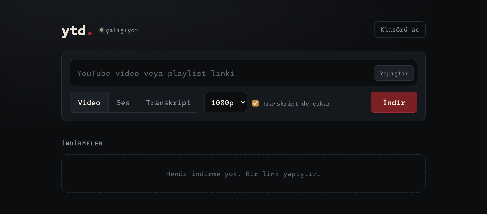

# ytd

Personal YouTube downloader: video, audio or just the transcript. A small local web UI that runs on the Mac (only on `127.0.0.1`), with [yt-dlp](https://github.com/yt-dlp/yt-dlp) underneath. The interface is in Turkish.



> Use it only for content you have the right to download (your own videos, content you have permission for, or freely licensed content) and in line with YouTube's terms of service.

## What it does

- **Video:** **AV1 + Opus (MKV)** by default, up to 2160p: about half the size of H.264 at the same quality (VLC and Chrome play it, QuickTime does not). Optionally **H.264 + AAC (MP4)**: opens in QuickTime, but YouTube serves H.264 only up to 1080p. Measurements: [docs/video-av1-olcum.md](docs/video-av1-olcum.md).
- **Audio:** M4A without re-encoding (~128 kbps; the "low" option is ~48 kbps), or **Opus** (YouTube's own Opus stream, ~110–150 kbps, also without re-encoding; saved as `.opus`). Cover art and metadata are embedded. Whisper accuracy with Opus is the same as with M4A and the file is a bit smaller: see [docs/opus-whisper-olcum.md](docs/opus-whisper-olcum.md).
- **Transcript:** uses the uploader's subtitles if there are any; otherwise it fetches only the audio temporarily and transcribes it on this Mac with Whisper (mlx-whisper). Writes `.txt` and a timestamped `.srt`.
- **"Transkript de çıkar" (also make a transcript):** adds the text next to every downloaded file.
- **Playlists:** a whole list from a single link; items downloaded before are skipped (`.archive-*.txt`).
- Files are saved as `~/Downloads/ytd/<channel>/<title> [<id>].<ext>`; "Klasörü aç" (open folder) shows them in Finder.

## Private, members-only and age-restricted videos

Public videos download without an account. If YouTube asks for an account for a video (a private video shared with you, a members-only video from a channel you belong to, age verification), the same request is retried once with your account. Instagram is also tried without an account first; the account is used only when needed, and sparingly (see below).

The account is read from ytd's own Chrome profile (`~/Library/Application Support/ytd/chrome`). You only need to sign in to this profile once: press the **Giriş** (sign in) button in the UI (or run `.venv/bin/python ytd.py --login`), sign in to YouTube (and Instagram if you like) in the Chrome window that opens, then close the window. On the first read macOS Keychain may ask for permission; choose "Always Allow". Cookies are kept only in memory and never written to disk.

Why a separate profile: macOS protects Chrome's main profile from other programs. Also, everyday browsing keeps rotating session cookies, so a sign-in in a separate profile stays valid longer.

### Going easy on the Instagram account

Instagram posts are tried without an account first; most public reels and posts download this way and the account is never touched. The account is used only for posts Instagram shows to signed-in users, and even then it is rate-limited: at most 30 signed-in requests per hour, at least 8 seconds apart. If Instagram starts blocking the account's requests (empty response, 429, verification), ytd stops making signed-in requests for 3 hours; posts that work without an account keep downloading in the meantime. The state is kept in `~/Library/Application Support/ytd/instagram_account.json`. For bulk downloads it is safer to sign in with a second Instagram account instead of your main one.

## Setup

Requirements: macOS, Python 3, `ffmpeg` (`brew install ffmpeg`). For Whisper transcripts: Apple Silicon and the mlx-whisper installed by the [Ses Bölücü](https://github.com/DenizTanisman/media-splitter) (media splitter) helper.

```sh
python3 -m venv .venv
.venv/bin/pip install -r requirements.txt
.venv/bin/python server.py          # http://127.0.0.1:8765
```

If you want it ready on every login:

```sh
./install-autostart.sh
```

launchd holds the port; the server starts when the page is opened and shuts down after 5 minutes idle (it does not run in the background all the time).

## Using it from Claude (MCP)

`mcp_server.py` exposes ytd to Claude as a tool (registered in Claude Code and Claude Desktop, server name `ytd`). Give Claude a link and say "get the transcript" or "download the video".

- `get_transcript`: first checks for a transcript already made on this Mac. If there is none, it reads subtitles **from the web**: the uploader's subtitles, or failing that YouTube's automatic captions (`… (otomatik altyazı).txt`). No media is downloaded in this step and it takes seconds. If there are no subtitles on the web (Instagram, videos without captions), it checks the Mac and, if conditions allow, downloads the audio temporarily and transcribes it with Whisper. `method="whisper"` gives the most accurate, punctuated text.
- `download`: downloads video or audio. It first gets the estimated size and checks free disk space and power.
- `system_check`: free disk, charging/battery, Low Power Mode, Whisper and ffmpeg.
- `job_status`: long jobs (Whisper, large downloads) run in the background. The Mac does not sleep while a job is running (`caffeinate`).
- `transcribe_local_file`: transcribes a file on the Mac with Whisper.

Rules: at least 5 GB must remain free after a download (`YTD_MIN_FREE_GB`), long jobs don't start on battery below 20% (`YTD_MIN_BATTERY`), and playlists are not accepted over MCP. Because the server runs on the Mac, the Mac has to be on and awake.

```sh
claude mcp add --scope user ytd -- ~/Projects/araclar/ytd/.venv/bin/python ~/Projects/araclar/ytd/mcp_server.py
```

## Command line

```sh
.venv/bin/python ytd.py URL                 # video (AV1 + Opus, MKV), up to 1080p
.venv/bin/python ytd.py -q 2160 URL         # 4K (AV1)
.venv/bin/python ytd.py --h264 URL          # MP4 that opens in QuickTime (H.264, up to 1080p)
.venv/bin/python ytd.py --opus URL          # audio only, Opus
.venv/bin/python ytd.py -a URL              # audio only
.venv/bin/python ytd.py -a --low URL        # small audio file
.venv/bin/python ytd.py -q 720 URL          # up to 720p
.venv/bin/python ytd.py --login             # sign in to an account in ytd's Chrome window
.venv/bin/python transcript.py URL          # subtitles if available, otherwise Whisper
.venv/bin/python transcript.py FILE.mp4     # transcript of a downloaded file
```

## Files

- `ytd.py` — yt-dlp settings and the command line.
- `server.py` — local web UI (FastAPI): preview, download queue, transcript, show in Finder.
- `transcript.py` — transcript from subtitles or Whisper.
- `mcp_server.py` — MCP server for Claude (web subtitles first, then Mac checks + Whisper).
- `static/` — the UI (single page, can be added to the home screen).
- `install-autostart.sh` — optional autostart with launchd.

## License

[MIT](LICENSE)
