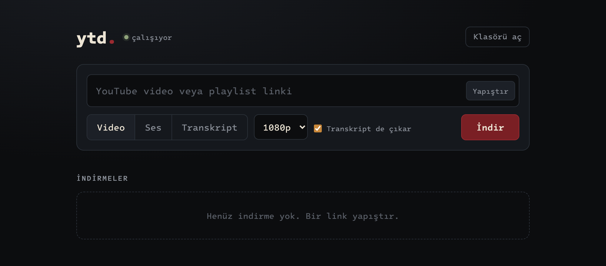

# ytd

Kişisel YouTube indirici: video, ses ya da sadece transkript. Mac'te çalışan küçük bir yerel web arayüzü (yalnızca `127.0.0.1`), arkada [yt-dlp](https://github.com/yt-dlp/yt-dlp).



> Yalnızca indirme hakkın olan içerik için (kendi videoların, izin verilen ya da serbest lisanslı içerik) ve YouTube'un kullanım koşullarına uyarak kullan.

## Neler yapar

- **Video:** 2160p'ye kadar, tercihen H.264/AAC MP4 (QuickTime ve tarayıcıda açılır).
- **Ses:** M4A, yeniden kodlamadan (~128 kbps; "düşük" seçeneği ~48 kbps). Kapak ve bilgiler gömülü.
- **Transkript:** yükleyenin altyazısı varsa onu kullanır; yoksa yalnızca sesi geçici olarak alıp bu Mac'te Whisper ile (mlx-whisper) yazıya çevirir. `.txt` ve zaman damgalı `.srt` yazar.
- **"Transkript de çıkar":** indirilen her dosyanın yanına metnini ekler.
- **Playlist:** tek linkle bütün liste; daha önce indirilenler atlanır (`.archive-*.txt`).
- Dosyalar `~/Downloads/ytd/<kanal>/<başlık> [<id>].<uzantı>` olarak iner; "Klasörü aç" Finder'da gösterir.

## Kurulum

Gerekenler: macOS, Python 3, `ffmpeg` (`brew install ffmpeg`). Whisper ile transkript için Apple Silicon ve [Ses Bölücü](https://github.com/DenizTanisman/ses-bolucu) yardımcısının kurduğu mlx-whisper.

```sh
python3 -m venv .venv
.venv/bin/pip install -r requirements.txt
.venv/bin/python server.py          # http://127.0.0.1:8765
```

Her açılışta kendiliğinden hazır olsun istersen:

```sh
./install-autostart.sh
```

launchd portu tutar; sayfa açılınca sunucu başlar, 5 dakika boşta kalınca kapanır (arka planda sürekli çalışmaz).

## Komut satırı

```sh
.venv/bin/python ytd.py URL                 # video, en fazla 1080p
.venv/bin/python ytd.py -a URL              # sadece ses
.venv/bin/python ytd.py -a --low URL        # küçük ses dosyası
.venv/bin/python ytd.py -q 720 URL          # en fazla 720p
.venv/bin/python transcript.py URL          # altyazı varsa altyazı, yoksa Whisper
.venv/bin/python transcript.py FILE.mp4     # indirilmiş dosyanın transkripti
```

## Dosyalar

- `ytd.py` — yt-dlp ayarları ve komut satırı.
- `server.py` — yerel web arayüzü (FastAPI): önizleme, indirme kuyruğu, transkript, Finder'da göster.
- `transcript.py` — altyazı ya da Whisper ile transkript.
- `static/` — arayüz (tek sayfa, ana ekrana eklenebilir).
- `install-autostart.sh` — launchd ile isteğe bağlı otomatik başlatma.
